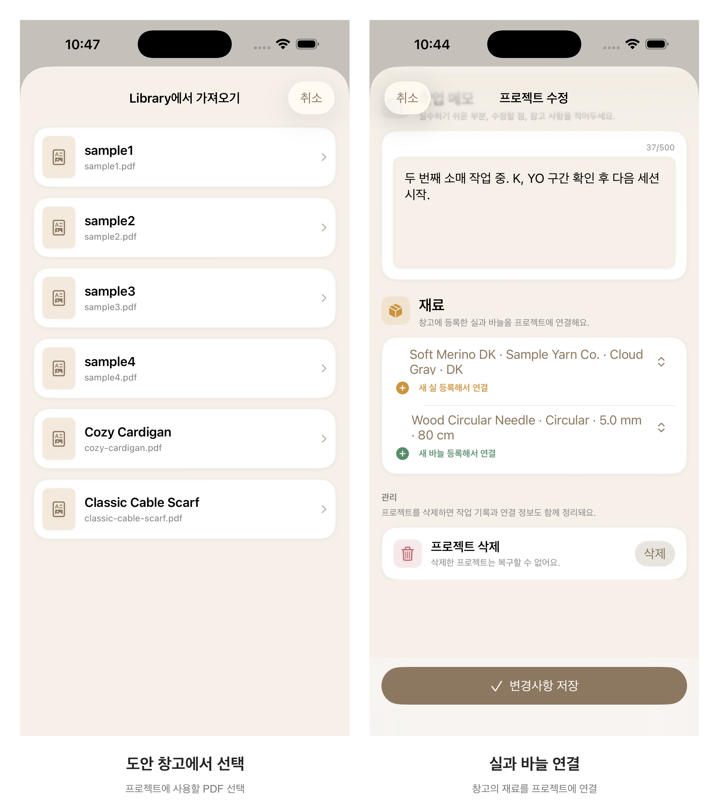
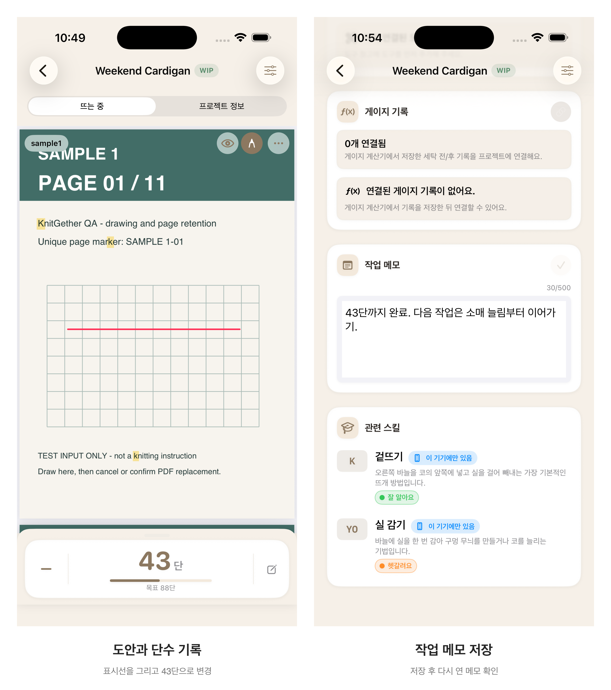
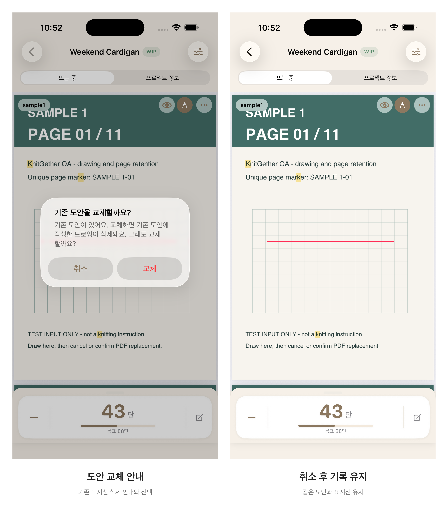
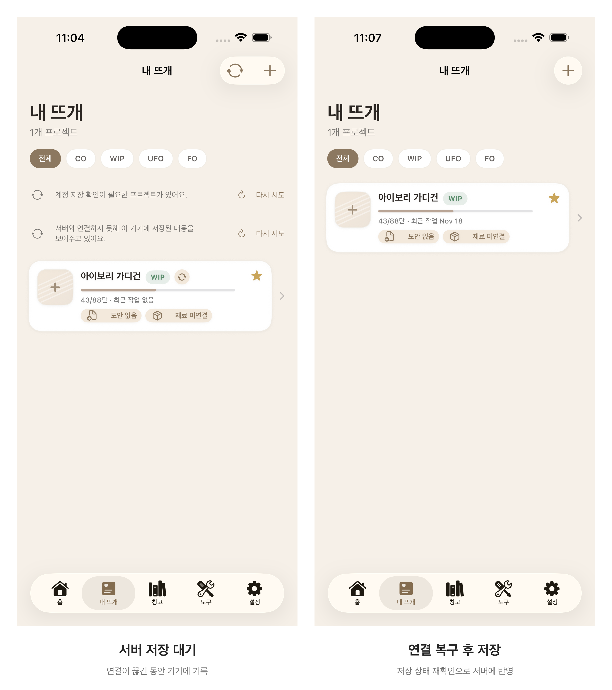
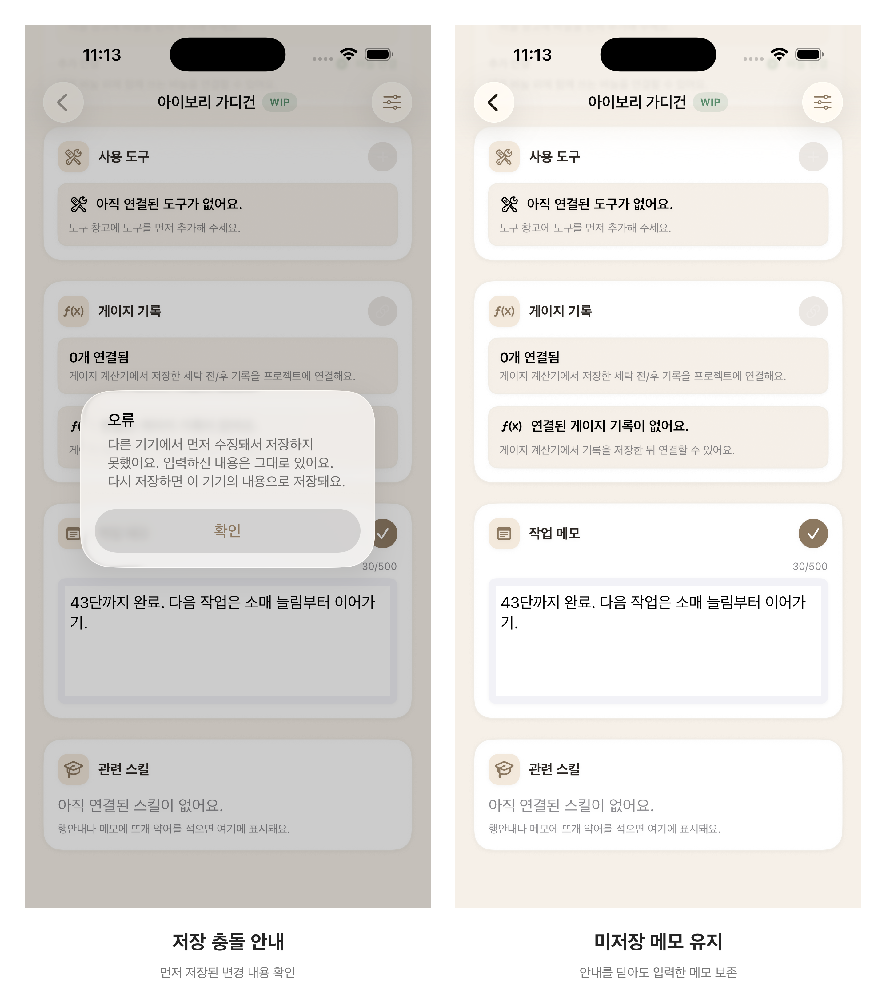

# 기능 화면과 저장 동작 확인

2026년 11월 18일에 추가한 기능 소개 화면 10장과 실제 동작 관찰입니다. Codex가 Appium으로 iOS 시뮬레이터를 조작하고 캡처와 근거를 수집했습니다. 화면은 두 장씩 묶어 5개 그림으로 정리했습니다.

## 실행 환경과 범위

iOS 26.5 전용 시뮬레이터 1대와 설치 앱 1.0 (1)을 사용했습니다. 도안과 재료 연결, 단수와 메모 기록, 도안 교체 취소는 로컬 저장 모드에서 확인했습니다. 저장 대기와 충돌은 별도로 만든 테스트 서버, PostgreSQL DB와 분리된 저장 경로에서 확인했습니다.

설치 앱의 정확한 소스 커밋은 이번 촬영에서 확정하지 않았습니다. 설치 파일의 해시와 아래 관찰값은 [관찰 기록](observations.json)에 남겼습니다. 이번 기록은 기능 소개를 위한 촬영과 명시한 동작 확인이며, 최초 수동 21건의 전체 재실행이나 실물 iPhone 검증이 아닙니다.

## 도안과 재료 연결

창고에서 샘플 PDF를 선택하고 실과 바늘을 프로젝트에 연결했습니다. 저장 뒤 프로젝트 정보에서 연결된 실과 바늘을 확인했습니다.

## 도안 확인과 작업 기록

샘플 PDF에 실제 표시선을 그리고 단수를 42에서 43으로 변경했습니다. 작업 메모를 저장한 뒤 프로젝트를 다시 열어 같은 메모가 남아 있는지 확인했습니다. 기기의 저장 파일에서도 43단과 같은 메모를 대조했습니다.

## 도안 교체 안내와 취소

표시선이 있는 기존 도안에서 PDF 교체를 선택해 삭제 안내를 확인했습니다. 취소한 뒤 같은 PDF, 표시선과 43단이 유지됐습니다. 교체 승인과 재실행 후 상태는 [2026년 10월 4일 실행 기록](../2026-10-04/README.md)과 구분합니다.

## 저장 대기와 연결 복구

전용 테스트 프록시로 앱의 서버 연결을 끊고 단수를 변경했습니다. 서버와 DB는 계속 실행한 상태였습니다. 연결이 끊긴 동안 기기에는 43단과 Pending Upload가 남았고, 서버 값은 42단이었습니다.

연결 복구 후 상단의 저장 상태 재확인 버튼을 눌렀습니다. 기기의 저장 상태는 Synced로 바뀌었고, API 응답과 SQL 조회에서 모두 43단을 확인했습니다. 연결 복구만으로 자동 저장됐다고 기록하지 않았습니다.

## 충돌 안내와 메모 보존

앱에서 메모를 입력한 뒤 저장하지 않은 상태에서, 별도 API 요청으로 서버에 다른 메모를 먼저 저장했습니다. 이후 앱에서 저장하자 충돌 안내가 표시됐고, 안내를 닫아도 입력 중이던 메모가 유지됐습니다. 서버에 먼저 저장한 메모도 덮어쓰지 않았습니다.

이번 충돌 조건은 시뮬레이터 1대와 별도 API 저장 요청으로 만들었습니다. [2026년 10월 26일의 두 기기 실행](../2026-10-26/README.md)과 구분하며, 이번 촬영을 두 기기 E2E 재실행으로 집계하지 않습니다.

## 이미지와 관찰값

검토본과 같은 이미지 파일을 사용했습니다. 앱 화면의 픽셀은 유지하고, 두 장을 나란히 배치한 뒤 화면 밖에 설명을 붙였습니다. [이미지 크기와 SHA-256](manifest.json), [기기 저장 상태와 API, SQL 관찰값](observations.json)을 함께 보존했습니다.

feature-screens 폴더의 overview.png와 skill-test-guidance.png는 [주요 화면과 기능](../../portfolio-guide.md#주요-화면과-기능)을 설명하기 위한 기존 화면입니다. 이번 추가 기능 캡처 10장에는 합산하지 않습니다.

[대표 검증 사례](../../portfolio-guide.md) / [테스트 설계와 범위](../../test-design.md) / [수행 결과](../../test-results.md)
