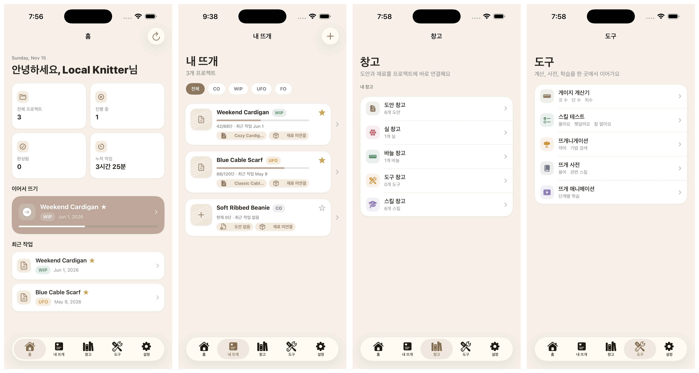
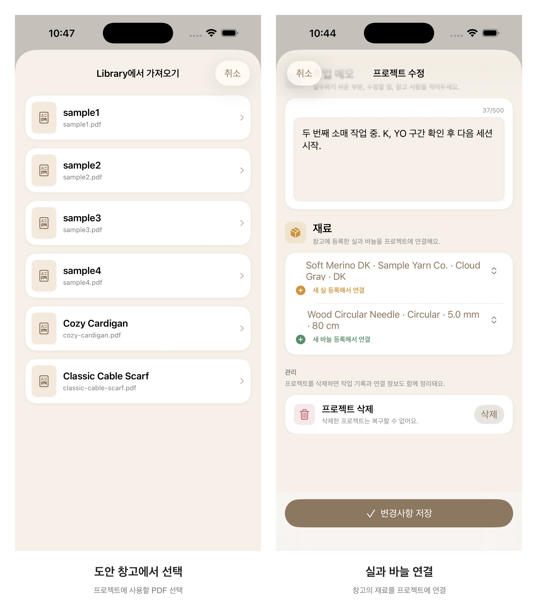
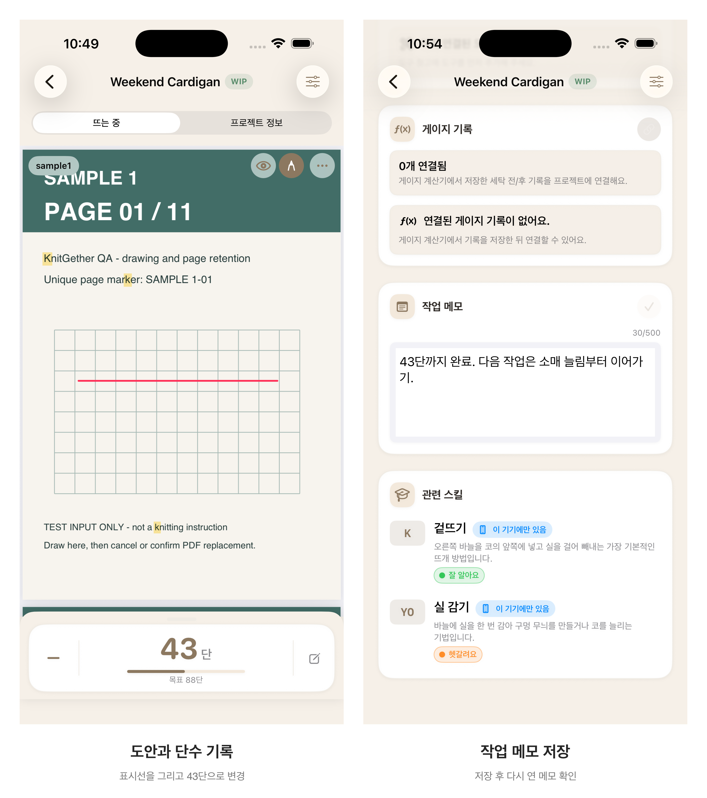
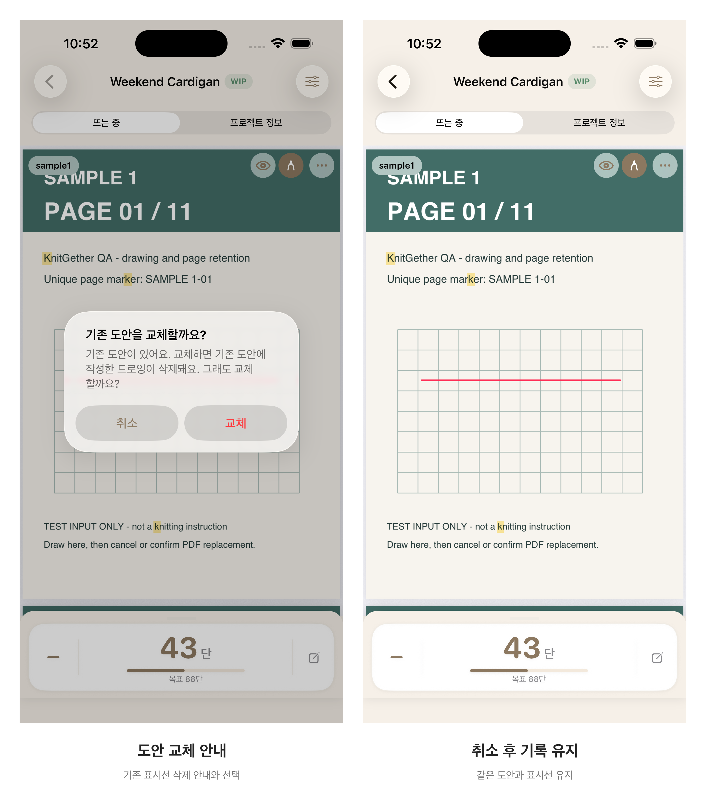
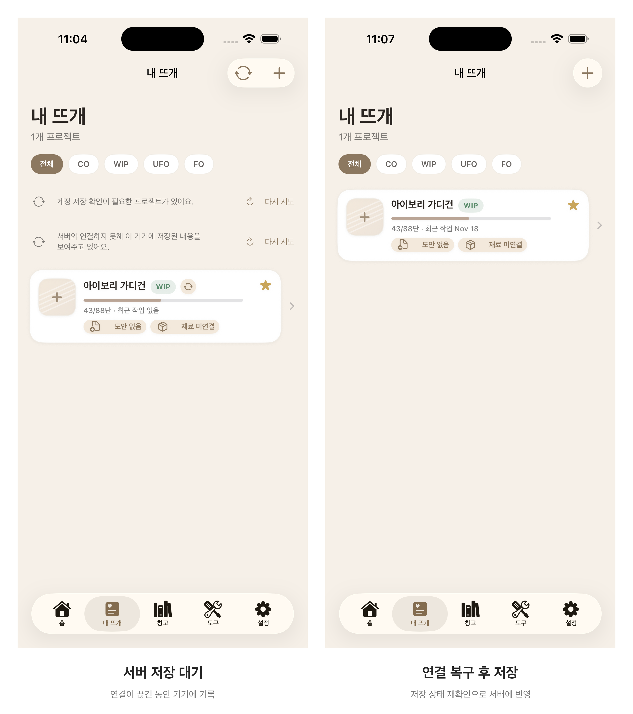
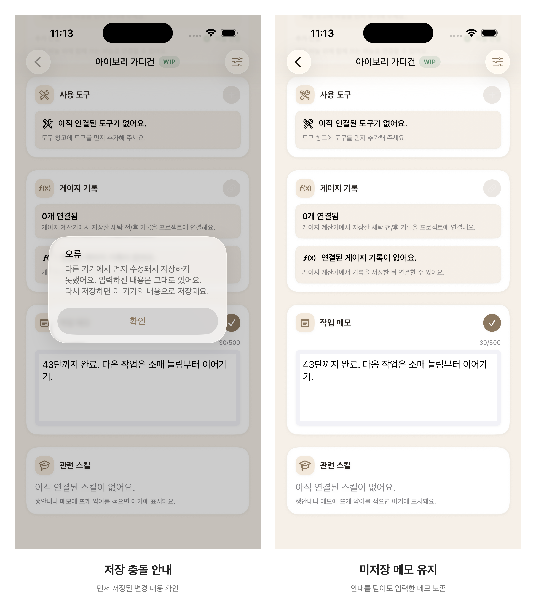
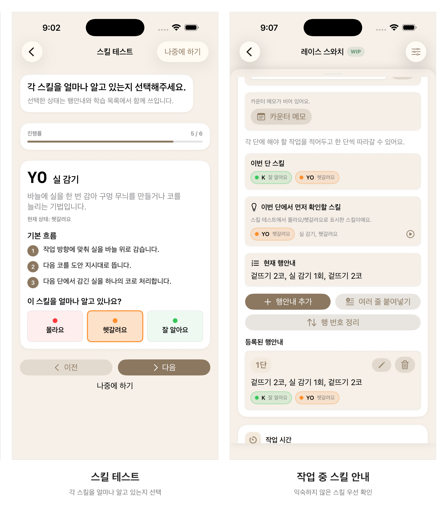

# 대표 검증 사례

뜨개더는 도안과 재료를 연결하고 단수(뜬 줄 수)와 메모를 기록하며, 스킬(뜨개 기법)을 학습하는 iOS 앱입니다. 사용자가 작업을 이어 가려면 화면에 보이는 값뿐 아니라 서버 저장값과 기기에 남은 기록도 일치해야 합니다. 이 문서는 그 위험을 어떻게 재현하고 판정했는지 세 사례로 안내합니다.

## 담당한 일과 AI 활용

기획과 기대 동작, 테스트 우선순위와 TC를 정했습니다. 화면 조작에는 Appium, 요청과 응답 확인에는 Postman과 Charles, 저장값 대조에는 SQL을 사용했습니다. 앱과 서버 구현, 수정 코드 작성, 후속 자동화 실행과 증거 수집에는 AI 도구인 Codex를 활용했습니다. 최초 수동 실행 기록과 후속 자동화 결과는 실행 조건과 시점을 구분해 정리했습니다.

## 주요 화면과 기능

### 주요 화면 구성

주요 화면은 진행 현황을 보는 ‘홈’, 작품별 작업을 이어가는 ‘내 뜨개’, 자료를 보관하는 ‘창고’, 계산과 학습을 돕는 ‘도구’로 나뉩니다.

왼쪽부터 홈, 내 뜨개, 창고, 도구입니다. 샘플 데이터를 사용한 iOS 시뮬레이터 화면이며, 내 뜨개는 저장 완료 상태로 구성했습니다.

### 도안과 재료 연결

창고에 보관한 도안, 실, 바늘과 도구를 작업 프로젝트에 연결합니다. 프로젝트별로 어떤 도안과 재료를 사용하는지 한곳에서 확인할 수 있습니다.

도안 창고에서 PDF를 선택하는 화면과 실, 바늘을 프로젝트에 연결하는 화면입니다. 기능 소개용 샘플 데이터를 사용해 실제 iOS 시뮬레이터에서 촬영했습니다.

### 도안 확인과 작업 기록

프로젝트에 연결한 도안을 보며 단수와 작업 메모를 기록합니다. 도안 위에 표시선을 그려 작업 위치나 확인할 부분을 남길 수 있습니다. ‘내 뜨개’에서 프로젝트를 다시 열어 저장된 단수와 메모를 확인하고 작업을 이어갑니다.

샘플 PDF에 표시선을 그리고 단수를 43단으로 변경한 화면과, 메모를 저장한 뒤 프로젝트를 다시 열어 확인한 화면입니다. 로컬 저장 모드에서 촬영했습니다.

도안을 다른 파일로 교체할 수 있으며, 기존 표시선이 있으면 삭제 안내를 표시합니다. 교체를 취소하면 기존 도안과 표시선을 유지하고, 승인하면 새 도안으로 바꾸고 이전 표시선을 제거합니다.

왼쪽은 도안 교체 전 표시선 삭제 안내와 취소, 교체 선택입니다. 오른쪽은 취소 후 기존 도안과 표시선, 43단이 유지된 모습입니다.

### 작업 기록 저장과 동기화

프로젝트의 작업 기록을 기기에 보관하고 서버와 동기화합니다. ‘내 뜨개’의 프로젝트 목록도 기기에 보관해 통신이 되지 않을 때 기존 기록을 확인할 수 있습니다. 목록을 새로 불러오면 서버에 저장된 변경 내용을 확인합니다.

별도 테스트 서버에 연결한 샘플 프로젝트입니다. 왼쪽은 연결이 끊긴 동안 기기에 43단을 보관한 상태이고, 오른쪽은 연결 복구 후 저장 상태 재확인 버튼을 눌러 서버에도 반영한 화면입니다.

다른 기기에서 같은 프로젝트를 수정할 수 있으며, 저장 내용이 충돌하면 안내합니다. 이때 입력 중인 메모를 유지하고, 사용자가 내용을 확인한 뒤 다시 저장할 수 있도록 구성했습니다.

테스트 서버에 다른 저장 요청을 먼저 반영해 충돌 상황을 구성했습니다. 왼쪽은 저장 충돌 안내이고, 오른쪽은 안내를 닫은 뒤에도 입력 중이던 메모가 유지된 모습입니다.

### 스킬 테스트와 작업 안내

앱을 처음 사용할 때 진행하는 온보딩 과정에서 스킬 테스트를 제공합니다. 사용자는 각 스킬의 약어와 이름, 설명을 보고 ‘몰라요’, ‘헷갈려요’, ‘잘 알아요’를 선택합니다. 이 응답을 바탕으로 작업 화면에서 현재 단에 필요한 스킬 중 익숙하지 않은 스킬을 먼저 안내합니다.

스킬 테스트에서 YO(실 감기)를 ‘헷갈려요’로 저장한 뒤, 테스트 프로젝트의 ‘이번 단에서 먼저 확인할 스킬’에 YO가 표시된 모습입니다.

아래 세 사례는 작업 기록을 저장하고 다시 불러오거나 도안을 교체하는 과정에서, 기록 유실과 오래된 값의 표시를 어떻게 확인했는지 설명합니다. [2026년 11월 18일 기능 화면의 실행 조건과 관찰값](evidence/2026-11-18/README.md)은 기존 심층 검증 기록과 구분해 남겼습니다.

## 1. 오래된 저장 요청이 최신 기록을 지우는가

**왜 확인했나:** 두 기기에서 같은 프로젝트를 수정하거나 요청이 늦게 도착하면, 정상적으로 저장한 작업 세션이 오래된 프로젝트 전체 저장 요청으로 사라질 수 있었습니다. 사용자가 다시 입력하기 어려운 기록 유실을 P1 위험으로 정했습니다.

**어떻게 판정했나:** 두 기기의 수정 순서와 요청 시점을 나누고 HTTP 응답, 부모 버전, 자식 행 ID와 최종 저장값을 대조했습니다. 충돌을 거부하는 것에 더해, 선행 저장과 미저장 메모가 모두 남고 사용자가 확인한 뒤 재저장할 수 있는지 확인했습니다. 프로세스 종료 뒤의 메모 복원은 별도 조건으로 검증했습니다.

**확인한 결과:** 오래된 전체 저장과 연관 데이터 변경의 경계를 수정한 뒤 실제 PostgreSQL을 사용하는 HTTP 테스트와 두 기기 실행 결과를 연결했습니다. 두 기기 근거는 메모와 단수 범위이며, 모든 입력의 보존을 입증한 것은 아닙니다.

- [결함과 원인, 수정 범위](defects.md)
- [두 기기의 화면과 HTTP, DB 결과](evidence/2026-10-26/README.md)
- [동시 요청과 롤백 테스트 코드](../../server/test/projects-concurrency.real-db-spec.ts)
- [미저장 입력과 초안 테스트](../../KnitGetherTests/ProjectWorkspaceViewModelTests.swift)

## 2. 조회 실패를 삭제로 오인해 정상 기록까지 잃는가

**왜 확인했나:** 한 프로젝트에 필수 단수 정보가 없을 때 목록 전체가 500으로 실패했습니다. 기존 캐시가 화면에 남으면 사용자는 정상 조회로 오해할 수 있고, 불완전한 목록을 실제 삭제로 해석하면 기기의 기록까지 지울 수 있었습니다.

**어떻게 판정했나:** SQL로 결손 조건을 만들고 정상 프로젝트의 서버값도 바꿔, 화면이 이전 캐시를 보여 주는지 실제 최신값을 받는지 구분했습니다. 응답 코드, 본문과 제외 ID, GET 전후 DB 미변경, 기기 캐시 보존을 따로 확인했습니다.

**확인한 결과:** 정상 항목은 목록에서 반환하고 조회 불가 항목을 구분하는 계약으로 보완했습니다. 개별 조회는 409, 타 계정은 기존 404를 유지하며, 앱은 조회 불가 항목을 삭제로 오인하지 않게 했습니다. 없는 단수를 0으로 추정하거나 GET으로 데이터를 복구하지 않습니다.

- [기대 결과와 상태 분리](test-design.md)
- [오류 주입과 수정 전후 실행](evidence/2026-10-31/README.md)
- [API와 SQL 테스트](../../qa/api-tests/test_13_row_counter_isolation.py)
- [캐시 병합 테스트](../../KnitGetherTests/OfflineFirstProjectRepositoryTests.swift)

## 3. 도안 교체의 취소와 승인을 구분했는가

**왜 확인했나:** 도안 위 표시선은 사용자가 남긴 작업 기록입니다. 교체를 취소했는데 표시선이 사라지거나 승인 후 이전 참조가 남으면 작업 맥락을 잃게 됩니다.

**어떻게 판정했나:** 표시선의 존재 여부와 교체 취소 또는 승인 여부를 조합해 기대 결과를 정하고, 교체 전후와 재실행 뒤 화면을 확인했습니다. 페이지 복귀 테스트는 빈 결과도 통과할 수 있던 판정을 보완해 고유 페이지 표시와 중간 화면 도착까지 확인했습니다.

**확인한 결과:** 기록된 로컬 실행에서 취소 시 도안과 표시선 보존, 승인 후 교체, 재실행 후 상태를 확인했습니다. 당시 설치 앱의 소스 커밋이 미확정이므로 현재 서버 동기화 전체의 통과 근거로 확대하지 않습니다.

- [화면과 실행 조건](evidence/2026-10-04/README.md)
- [UI 실행 스크립트](../../qa/appium/capture_portfolio.py)
- [잘못된 판정을 바로잡은 기록](test-results.md)

## 실행 수치를 읽는 방법

아래는 기존 실행 기록의 요약이며 이 문서를 추가하면서 다시 실행한 결과는 아닙니다. 서로 다른 계층의 수치를 더해 E2E 통과 건수로 표시하지 않습니다.

| 실행 | 기록된 결과 | 의미 |
|---|---|---|
| 최초 수동 실행 | 설계 22건 중 수동 21건: 10 PASS / 11 FAIL | 나머지 1건은 단위 테스트로 대체 |
| 단수 하한 수정 후 사이클 기록 | 11 PASS / 10 FAIL | 최초 결과와 구분 |
| 2026-10-31 서버 / 실제 DB와 HTTP / API | 각각 180 / 40 / 79 PASS | 계층과 실행 범위가 다름 |
| 같은 날 Swift | 365 PASS / 41 suites | 앱 내부 상태와 캐시, 입력 등 |
| 실제 iPhone 로컬 흐름 | 고유 시나리오 최종 2 PASS | 가입과 서버 동기화는 미완료 |

현재 남은 확인은 실제 iPhone의 가입과 계정 전환, 서버 동기화, 여러 OS와 기기 조합, 장시간 부하 등입니다. DEF-27과 DEF-28은 수정 커밋과 빌드 성공만 확인했으며, 전용 동작 테스트 근거는 없습니다. 상세 실행 소스, 환경과 제약은 [테스트 결과](test-results.md)에서 확인할 수 있습니다.

[전체 설계](test-design.md) / [실행 환경](../setup.md) / [저장소 처음으로](../../README.md)
