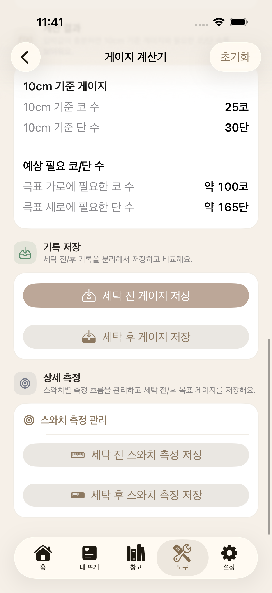
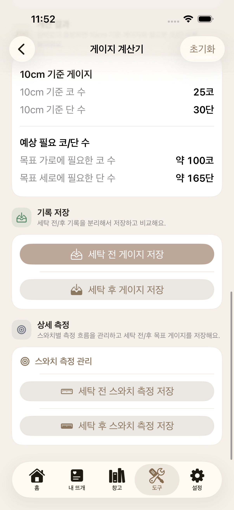

# 뜨개더 QA 포트폴리오

이 저장소는 뜨개더의 앱 코드와 QA 판단·실행 근거를 함께 제공합니다. 처음에는 이 문서의 세 사례를 읽고, 필요한 부분만 연결된 TC·HTTP·SQL·화면으로 확인할 수 있습니다.

## 프로젝트와 역할

뜨개더는 도안·단수·메모·작업 기록·재료를 한 프로젝트에서 관리하는 iOS 앱입니다. 기록 유실과 계정 간 노출을 높은 위험으로 두고 화면·API·서버 DB·기기 저장소의 일치 여부를 확인했습니다.

| 구분 | 담당 내용 |
|---|---|
| 유하은의 판단·결정 | 앱 기획, 테스트 우선순위·기대 결과, SYNC-11의 서버 값·입력 보존 및 직접 재저장 기준, cm 고정, 계정·프로젝트별 기기 초안 보존과 저장 성공·명시적 삭제 시 제거 정책, main 병합·로컬 검증 범위 |
| 기존 직접 수행 이력 | 수동·Postman·Charles·SQL 및 Appium 관련 수행은 [제출 본문](portfolio.md)과 [수동 실행 기록](../portfolio/06_manual_execution.md)의 당시 조건에 따름 |
| Codex의 후속 수행 | 2026-10-24~26 코드·기존 TC 분석, 격리 환경 구성, 재현·구현, 실제 시험·판정, 화면·HTTP·SQL 증거화, 문서 보완, 코드 리뷰와 PR 병합 실행 |

AI가 실행한 후속 시험을 유하은의 직접 수동 수행으로, Codex 자체 리뷰를 독립된 사람의 승인으로 표현하지 않습니다. 구현 참여와 QA 요구사항 결정을 구분합니다.

## 사례 1 · SYNC-11 동시 수정에서 기록 보존

**문제:** 같은 계정으로 프로젝트를 연 두 기기가 같은 버전을 수정하면 나중 요청이 먼저 저장한 데이터를 덮을 수 있습니다. 저장 거부만으로는 기기 B의 입력 보존과 복구까지 보장되지 않습니다.

**판단:** A의 선행 저장은 서버에 유지하고, B에는 409 안내와 미저장 입력을 남겨야 합니다. 재조회·앱 종료 후 복구를 거쳐 사용자가 직접 재저장해야 하며 자동 재저장은 하지 않습니다.

**실행:** 독립 iOS 시뮬레이터 두 개를 같은 서버·합성 계정에 연결했습니다. B 미저장 입력 → A 저장 → B 409 → 서버 A 값 및 B 입력·안내 → 직접 재저장 → 최종 SQL을 연결했습니다. 화면 전용 확인과 UI/API 혼합 확인을 구분했습니다.

**근거:** [두 기기 19개 확인·초안 3개·오프라인 2개](../../../qa-runs/2026-10-26-session-fix/report.md) · [항목별 결과](../../../qa-runs/2026-10-26-session-fix/case-results.md) · [목록 삭제 후 초안 정리 추가 결함](../../../qa-runs/2026-10-26-draft-delete-fix/report.md)

이 결과는 각 보고서의 당시 빌드 기준입니다. 아래 최종 앱에서 전체 시나리오를 다시 실행한 결과로 합산하지 않습니다. 자동 재저장 없음은 300초 관찰 범위입니다.

## 사례 2 · 자식 변경을 오래된 전체 저장이 덮는 문제

**확장한 검증:** 메모 간 충돌을 막아도 카운터·행 안내·작업 세션·도안 전용 API의 성공이 같은 프로젝트 버전에 반영되지 않으면 데이터가 사라질 수 있습니다.

| 단계 | 실제 확인 |
|---|---|
| 수정 전 재현 | 행 안내 생성·수정·삭제와 PDF·드로잉·드로잉 삭제 뒤 오래된 전체 저장이 HTTP 200: 신규 6 FAIL, 기존 24 PASS |
| 추가 발견 | 다른 프로젝트의 자식 ID 재사용 3 FAIL. QA-CMP-04 클라이언트 저장 순서는 정적 검토 발견이며 과거 UI FAIL로 표현하지 않음 |
| 수정 | 부모 버전 잠금·트랜잭션, owner/project 범위 검사, 드로잉 UUID 파일과 롤백 보상 정리, 온라인 저장 후 중복 PATCH·캐시 파일 재업로드 방지 |
| 재검증 | 실제 HTTP + PostgreSQL 40 PASS / 0 SKIP. 자식 변경 후 409, 실패 시 버전·기존 파일 바이트 보존, 동일·다른 계정의 ID 격리, 독립 자식 보존 포함 |

[수정 전 로그](../../../qa-runs/2026-10-26-completion/evidence/child-red.log) · [ID 범위 수정 전 로그](../../../qa-runs/2026-10-26-completion/evidence/scope-red.log) · [수정 후 HTTP·SQL](../../../qa-runs/2026-10-26-completion/evidence/child-verified.json) · [TC별 결과](../../../qa-runs/2026-10-26-completion/case-results.md) · [코드 리뷰](../../../qa-runs/2026-10-26-completion/code-review.md) · [구현 PR #48](https://github.com/uhaeun/knitgether-app/pull/48)

## 사례 3 · UI-03 cm 고정과 과거 단위값

단위 선택이 보이지 않는 것만으로 계산 정책 충족을 판단하지 않았습니다. 온보딩·회원가입·프로필·설정을 확인하고, DB의 preferredUnits에 Metric/Imperial/US/cm를 주입한 뒤 실제 프로필 응답과 계산 결과를 연결했습니다.

- 입력: 가로 8cm·세로 10cm / 20코·30단 / 목표 40×55cm.
- 기대: 10cm 기준 25코·30단, 목표 약 100코·165단. 과거 단위값과 무관하게 동일.
- 결과: 최종 앱을 두 독립 시뮬레이터에 설치해 A12+B12=24 PASS. 이 중 legacy 계산은 기기별 4조건입니다.

| A 기기 · legacy Imperial | B 기기 · legacy cm |
|:---:|:---:|
|  |  |

실제 촬영한 원본 화면입니다. [A 결과](../../../qa-runs/2026-10-26-completion/evidence/ui03-results-A.json) · [B 결과](../../../qa-runs/2026-10-26-completion/evidence/ui03-results-B.json) · [화면·응답 증거 대조](../../../qa-runs/2026-10-26-completion/evidence/completion-audit.json). 81개 증거 대조 항목을 TC 81개로 추가 집계하지 않습니다.

## 결과와 추적성

| 층 | 최종 실행 | 확인 근거 |
|---|---|---|
| 실제 HTTP + PostgreSQL | 40 PASS / 0 SKIP | [TC JSON](../../../qa-runs/2026-10-26-completion/evidence/child-case-results.json) |
| 서버 경로·파일 회귀 | 147 PASS | [실행 로그](../../../qa-runs/2026-10-26-completion/evidence/server-final.log) |
| API·네트워크·DB | 75 PASS | [실행 로그](../../../qa-runs/2026-10-26-completion/evidence/api-verified.log) |
| Swift | 359 PASS / 41 suites | [실행 로그](../../../qa-runs/2026-10-26-completion/evidence/swift-results.log) |
| 네이티브 UI-03 | 24 PASS | [TC별 표](../../../qa-runs/2026-10-26-completion/case-results.md) |

독립 계층의 수치를 전체 E2E 건수로 합산하지 않습니다. [기능 기준](../portfolio/02_functional_spec.md) → [TC/RTM](../portfolio/09_test_case_master.md) → [결함 대장](../portfolio/10_defect_catalog.md) → [실행 보고서](../../../qa-runs/2026-10-26-completion/report.md)에서 요구사항과 수정 후 결과를 추적합니다. 과거 FAIL·SKIP은 당시 이력으로 남깁니다.

## 완료 범위와 한계

- 제품 기준 `0d0ba222078f4e58cd7acc24ff1133e0590285d8`: [PR #48 병합](https://github.com/uhaeun/knitgether-app/pull/48). 검토 head는 `fc08532e1332a7a71d59ac851d9d4fe4f9676af8`입니다.
- [PR 최종 CI](https://github.com/uhaeun/knitgether-app/actions/runs/40344731655)와 [병합 후 main CI](https://github.com/uhaeun/knitgether-app/actions/runs/40348286022) 각각 4개 job 성공. [상태 스냅샷](evidence/2026-10-27-handoff/main-CI-status.json)을 보존했습니다.
- 병합 main의 로컬 서버 빌드와 실제 HTTP/SQL 충돌·수동 재저장·자식 변경 보호를 재확인했습니다. [HTTP·SQL](evidence/2026-10-27-handoff/main-smoke.json) · [빌드](evidence/2026-10-27-handoff/main-build-status.json)
- 병합 main과 제품 소스가 같은 앱으로 두 QA 시뮬레이터에서 실행을 확인했습니다. 이 로컬 확인은 전체 E2E 재실행이 아닙니다. [소스 대조](evidence/2026-10-27-handoff/main-source-audit.json) · [앱 실행](evidence/2026-10-27-handoff/main-native.json)
- QA DB·백업은 로컬에 보존했고 서비스는 종료했습니다. 토큰·비밀번호·Appium 세션·원본 로그·DB dump는 공개 자료에 포함하지 않습니다.
- 운영/TestFlight 배포, 이번 변경의 실물 iPhone 전체 검증, 장기 부하/SLA, 모든 파일·계정 전환 조합과 과거 고아 파일 일괄 정리는 미실행입니다. 기존 결함의 상태는 결함 대장의 해당 시점 기록을 따릅니다.

## 실행 방법과 이전 자료

소스 실행은 [개발 모드](../../dev/modes.md)와 [로컬 개발](../../dev/09_local_device_development.md), 최종 검증 재현은 [RUNBOOK](../../../qa-runs/2026-10-26-completion/RUNBOOK.md)을 따릅니다. 실행 경로·시뮬레이터 ID·전용 DB는 자신의 환경에 맞게 준비해야 합니다. 기록된 포트가 현재 실행 중이라는 의미는 아닙니다.

[제출 본문](portfolio.md)과 [제출 PDF](../../../output/pdf/knitgether_qa_portfolio.pdf)는 2026-10-28에 초기 대표 사례와 최신 후속 정책·결과·한계를 통합했습니다. PDF는 14쪽이며 기존 11쪽에 후속 검증 3쪽을 추가했습니다. [이번 검수·Windows 회귀 실패·미실행](../validation/2026-10-28/README.md)을 함께 확인합니다. 기존 Mac 통과 결과를 이번 Windows 새 실행 결과로 읽지 않습니다. [QA 상세](../portfolio/README.md) · [회차별 실행](../../../qa-runs/README.md)
