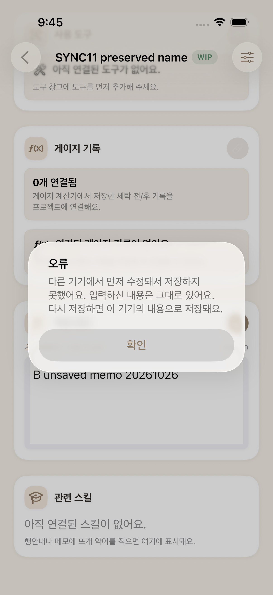

# 뜨개더 QA 포트폴리오

## 01 작업 기록을 기준으로 검증한 iOS 앱

**유하은 | Tibero DB QA 5년차 | 개인 프로젝트**

뜨개더는 도안(뜨개 작업 설명서)을 보며 단수(완료한 줄 수)를 기록하고, 작업 메모와 재료를 관리하는 iOS 앱입니다. 뜨개질을 하며 도안과 용어 검색, 단수 기록을 따로 관리해야 했던 불편함에서 시작했습니다. 도안을 보다가 모르는 기술을 찾아보고, 돌아와 작업을 이어갈 수 있도록 기능을 연결했습니다.

DB QA에서 다루던 기능과 버그 수정 검증을 넘어, 서비스의 기대 동작을 정하고 사용자 흐름에서 문제를 찾아 개선하는 과정을 경험하고자 진행했습니다. 특히 사용자가 남긴 기록을 잃거나, 잘못된 상태를 믿고 작업하는 상황을 우선했습니다.

### 이 프로젝트에서 보여주고 싶은 것

| 대표 사례 | QA의 판단 | 확인 근거 |
|---|---|---|
| 도안 교체 시 드로잉 유실 | 교체 성공과 기록 삭제의 동의를 별도로 판단 | 취소·승인 화면과 자동화 |
| 한 항목의 오류로 목록 전체 실패 | 화면의 이전 값과 실제 조회 실패를 구분 | HTTP 응답과 SQL 저장값 |
| 두 기기 동시 수정 | 서버 선행값과 미저장 입력을 함께 보호 | 충돌 화면, HTTP 409, 최종 DB |

### 프로젝트 구성

SwiftUI 앱은 로컬 저장을 지원하며, 서버 모드에서는 NestJS API와 Prisma·PostgreSQL을 사용합니다. 수동 검증과 Postman·Charles·SQL로 현상을 확인하고, Appium·pytest·Swift 테스트와 GitHub Actions로 반복 확인 범위를 넓혔습니다.

이 문서는 기획과 QA 판단을 중심으로 대표 사례를 설명합니다. 각 사례의 링크에서 당시 조건과 원본 결과를 확인할 수 있습니다.

[소스와 실행 방법](../../../README.md) / [기능 기준](../portfolio/02_functional_spec.md) / [테스트·결함 추적표](../portfolio/09_test_case_master.md)

## 02 무엇을 먼저, 어떻게 검증했는가

### 작업이 끊기는 지점에서 우선순위를 정했습니다

| 우선 검증 영역 | 위험 | 검증 기준 |
|---|---|---|
| 저장·동기화·계정 전환 | 유일한 기록 유실, 이전 계정 데이터 노출 | 서버·기기 상태 대조, 소유 범위 확인 |
| 도안 교체·앱 종료 | 사용자가 예상하지 못한 기록 삭제 | 취소·복구 경로와 삭제 안내 확인 |
| 화면 이동·목록 갱신 | 작업 위치 초기화, 이전 값을 최신으로 오인 | 이동 전후 맥락과 실제 조회 결과 대조 |

기능별 기대 동작을 정리한 뒤 명세와 코드를 대조했습니다. 앱에서 문제를 재현하면 API 응답, DB 저장값, 기기 저장 상태를 함께 확인해 발생 지점을 좁혔습니다. 결함에는 재현 조건과 기대·실제 결과를 남기고, 수정 확인과 주변 기능의 회귀 검증을 연결했습니다.

### 한 도구로 판단하기 어려운 부분은 다른 관측으로 보완했습니다

| 방법 | 확인한 내용 | 범위 |
|---|---|---|
| 앱 조작·Appium | 교체 취소, 화면 복귀, 충돌 안내와 입력 보존 | 사용 흐름과 화면 상태 |
| Postman·Charles·pytest | 요청·응답, 실패·지연·재시도 조건 | API 계약과 네트워크 조건 |
| SQL·실제 PostgreSQL 시험 | 저장값, 자식 기록, 트랜잭션과 경합 | 화면과 독립된 데이터 확인 |
| Swift 테스트 | 초안 복구, 계정·프로젝트별 저장 격리 | 앱 내부 동작 |

초기 수동 검증은 22건을 설계해 21건을 실행했고, 당시 결과는 11 PASS·10 FAIL이었습니다. 이후 수정 결과는 최초 판정과 구분해 남겼습니다.

### 본인의 역할과 AI 활용

앱 기획, 테스트 우선순위와 기대 결과, 충돌 시 입력 보존 및 직접 재저장 정책을 정했습니다. 기존 수동·Postman·Charles·SQL 수행 이력을 바탕으로 사례를 구성했습니다. AI는 앱·서버 구현, 코드 분석과 후속 수정, 자동화 구현·실행·증거 수집에 활용했습니다.

[수동 실행 원본](../portfolio/06_manual_execution.md) / [API·네트워크 검증](../portfolio/07_api_and_network.md) / [역할과 회차별 조건](technical-summary.md)

## 03 도안 교체가 성공해도 정상은 아니었습니다

**DEF-10 | 삭제 안내와 취소 시 기록 보존**

기존 도안에 드로잉(작업 중 남긴 선 표시)을 남긴 뒤 다른 도안으로 교체하자, 안내나 확인창 없이 선이 사라졌습니다. 교체 자체는 성공했지만 사용자가 남긴 기록이 사전 안내 없이 삭제됐습니다.

교체 전에 드로잉이 삭제된다는 사실을 알리고, 취소하면 기존 도안과 선을 유지하며, 승인했을 때만 교체하도록 검증 기준을 정했습니다. 수정 후에는 다음 두 경로를 나눠 확인했습니다.

| 취소 후: 도안 A와 선 유지 | 승인 후: 도안 B로 교체, 선 제거 |
|:---:|:---:|
|  |  |

촬영: 2026-10-04 후속 자동화 실행. 로컬 모드의 PDF 직접 교체 경로입니다. 설치 앱의 소스 커밋은 확정되지 않았으며 서버 동기화의 통과 근거로 사용하지 않습니다.

Appium은 ‘그리기 삭제’ 메뉴의 표시로 드로잉 상태를 간접 검사했고, 실제 선의 유지와 제거는 화면으로 보완했습니다. 자동화의 관측값이 무엇을 증명하는지 확인한 사례입니다.

[최초 재현과 수정 기록](../portfolio/06_manual_execution.md) / [화면·로그·실행 조건](evidence/2026-10-04/README.md)

## 04 목록이 보여도 최신 조회는 실패할 수 있습니다

**DEF-08 | 화면·API·DB를 연결한 원인 분석**

프로젝트 하나의 단수 정보만 SQL로 제거하자 목록 API 전체가 HTTP 500으로 실패했습니다. 앱에는 이전 목록이 남아 있어 화면만 보면 정상처럼 보였습니다.

정상 프로젝트의 서버 단수를 22에서 99로 바꾼 뒤 새로고침했지만 화면은 22였습니다. DB에는 99가 저장돼 있었고 API는 실패했습니다. 정적 분석 때 예상한 클라이언트 해석 오류보다 앞선, 서버 응답 생성 단계의 문제였습니다.

### 목록·개별 조회와 기기 기록을 함께 보완했습니다

목록은 프로젝트별 오류를 분리해 정상 항목을 반환하도록 수정했습니다. 2026-10-29 재검증에서는 **행 삭제**와 **삭제 상태 변경** 모두 정상 단수 99의 반환을 확인했습니다. 이 회차에는 앱 화면을 새로 시험하지 않았습니다.

| 확인 지점 | 최초 문제 | 10월 31일 보완 결과 |
|---|---|---|
| 목록 API | 전체 HTTP 500 | 200, 정상 항목과 제외 ID 전달 |
| 오류 항목 개별 조회 | HTTP 500 | 409, 구분 가능한 오류 코드 |
| 제외된 항목의 기기 캐시 | 실제 삭제로 오인할 수 있음 | 캐시 보존, 최신 조회 불가 안내 |

개별 조회는 행 삭제·삭제 표시·소유자 불일치에서 409를 반환하고, 다른 계정에는 기존 404를 유지했습니다. 조회 전후 단수·메모·작업 세션이 바뀌지 않았으며, 정확한 시험 사본으로 결손을 되돌린 뒤 원래 단수 37과 200 응답을 확인했습니다. 유실 값을 추정하는 자동 복구는 추가하지 않았습니다.

서버가 오류 항목을 제외했을 때 앱이 캐시까지 정리할 수 있는 경로도 발견했습니다. 제외 ID를 응답 헤더로 전달해 실제 삭제와 구분했습니다. 내부 시험에서 정상 단수 99 반영, 실제 삭제 정리, 오류 항목 보존·디스크 재로딩과 미저장 메모 유지를 함께 확인했습니다.

[최초 실행](../portfolio/06_manual_execution.md) / [API·SQL 회귀](../../../qa/api-tests/test_13_row_counter_isolation.py) / [조회 정책·보존 결과](../validation/2026-10-31/integrity-device/README.md)

## 05 충돌을 막은 뒤에도 다시 저장할 수 있어야 합니다

**SYNC-11 | 선행 저장과 미저장 입력의 동시 보호**

같은 계정의 두 기기가 하나의 프로젝트를 수정하면 오래된 내용이 먼저 저장한 값을 덮을 수 있습니다. 저장을 거절하더라도 작성 중인 메모가 사라진다면 기록을 보호했다고 볼 수 없었습니다.

서버에는 먼저 저장한 값을 남기고, 나중 기기에는 충돌 안내와 미저장 입력을 유지하도록 정했습니다. 재조회 후 사용자가 직접 저장하며, 자동 재저장은 하지 않는 기준입니다. 초안은 계정·프로젝트별 기기에 보관하고 저장 성공 또는 명시적 삭제 시 정리합니다.

| 확인 순서 | 판정 기준과 당시 결과 |
|---|---|
| B 입력 → A 저장 → B 저장 | HTTP 409, DB의 A 메모 유지 |
| B의 충돌 화면 | 안내와 B 입력 유지 |
| B에서 직접 재저장 | DB에 B 메모 저장, 시험한 다른 필드 유지 |
| 앱 종료·재실행 | 초안 복구, 버리기 후 미복구 |

<!-- photo-width: 144 -->

| 충돌 안내와 남아 있는 미저장 메모 |
|:---:|
|  |

촬영: 2026-10-26 두 시뮬레이터 후속 자동화. 기본 12개는 UI/API 혼합, 보완 7개는 양쪽 변경을 화면에서 수행했습니다. 자동 재저장 없음은 300초 관찰이며, 메모·단수 외 모든 입력의 보존을 보장하지 않습니다.

[순서별 화면·HTTP·SQL](../../../qa-runs/2026-10-26-session-fix/report.md) / [충돌 후 DB](../../../qa-runs/2026-10-26-session-fix/evidence/sync-04-after-conflict-db.json) / [재저장 후 DB](../../../qa-runs/2026-10-26-session-fix/evidence/sync-05-final-db.json)

## 06 메모 충돌에서 연관 데이터까지 확인 범위를 넓혔습니다

### 부분 변경 후 오래된 전체 저장이 들어오는 경우

메모 간 충돌을 막아도 단수·작업 세션·행 안내·도안 전용 API의 변경이 프로젝트 버전에 반영되지 않으면, 오래된 전체 저장이 성공할 수 있습니다. 프로젝트에 속한 연관 데이터(자식 기록)를 지우거나 삭제한 기록을 되살리는 위험입니다.

후속 검증에서는 행 안내 생성·수정·삭제와 PDF·드로잉 변경 뒤 오래된 전체 저장이 HTTP 200으로 성공하는 6개 실패를 재현했습니다. 다른 프로젝트의 자식 ID 재사용 3개 실패도 확인했습니다. 모두 후속 자동화 실행에서 얻은 결과입니다.

| 보완 범위 | 확인 기준 |
|---|---|
| 부모 버전과 자식 변경 | 같은 트랜잭션에서 처리, 오래된 전체 저장은 409 |
| 실제 동시 요청 | 같은 기준 버전에서 한 요청만 성공, 패자 기록 유입 없음 |
| 중간 실패 | DB와 기존 파일 바이트 보존 |
| 자식 ID 재사용 | 다른 계정·프로젝트의 기록 수정 차단 |

2026-10-26 수정 후 실제 HTTP·PostgreSQL 40개가 통과했습니다. 2026-10-29에도 같은 회귀 40개를 새 전용 DB에서 재실행해 모두 통과했습니다. DB 조회·쓰기에는 실제 SQL을 사용하고, 읽기 순서와 실패 시점은 테스트 훅으로 제어합니다. 일반 사용자의 장기 부하 시험과는 구분합니다.

### 화면 흐름에서 확장한 기준: 도안 페이지 유지

사전에서 돌아오면 보던 페이지가 유지됐지만 홈 탭을 거치면 1페이지로 초기화됐습니다. 두 경로 모두 작업을 이어가는 흐름으로 보고, 탭 복귀까지 페이지 유지 범위를 넓혔습니다. 실제 3페이지 이동과 고유 표시를 기준으로 두 경로를 확인했습니다. 확대율·페이지 안의 스크롤 위치·앱 재실행 후 복원은 당시 범위에서 제외했습니다.

[동시성 시험 코드](../../../server/test/projects-concurrency.real-db-spec.ts) / [수정 전후 결과](../../../qa-runs/2026-10-26-completion/report.md) / [페이지 복귀 증거](evidence/2026-10-04/README.md)

## 07 실행 결과는 환경과 계층을 나눠 읽습니다

### 2026-10-31 전용 환경과 원격 CI

| 검증 | 결과 | 의미 |
|---|---|---|
| 서버 회귀 | 180 PASS | HTTP 계약과 파일 경로·저장 경로 |
| 실제 HTTP·PostgreSQL | 40 PASS, 0 SKIP | 경합, 롤백, 자식·파일 보존 |
| API·네트워크·DB | 79 PASS, 0 xfail | 목록 2조건·개별 조회 3조건 포함 |
| Swift 내부 시험 | 365 PASS / 41 suites | 캐시·초안 보존과 오류 구분 포함 |
| 시뮬레이터 UI smoke | 3 PASS | 가입·저장, 오프라인 동기화, 캐시 조회 |

최신 회귀의 제품 소스는 `5bcbaae`입니다. 실기기 대화상자 처리를 보완한 `f0663a6`은 앱 소스가 같습니다. Windows·Linux CI의 파일 경로 회귀는 각각 33개 통과했으며 서버 180개에 포함됩니다. 서로 겹치는 계층을 전체 E2E 건수로 합산하지 않았습니다.

### 화면 시험의 실패와 재검증도 남겼습니다

앞선 CI는 온보딩의 계정 화면 진입에서 2 PASS·1 FAIL이었습니다. 시뮬레이터 부팅 준비와 목적 화면 도착 확인을 보완한 뒤 로컬·원격 UI smoke가 통과했습니다. 최초 실패의 내부 원인은 확정하지 않고 관측값과 후속 조건을 보존했습니다.

### 실제 기기와 과거 화면의 구분

iPhone 16 Pro·iOS 27.0.1에서 비로그인 상태의 단수 1이 백그라운드 복귀와 앱 재실행 뒤 유지됐습니다. 카메라 권한 거부 시 설정에서 허용하도록 안내를 보완했고, 안내를 닫고 돌아온 단수 1까지 확인했습니다. 비로그인 로컬 흐름 2개의 최종 결과는 PASS입니다. 계정 가입·서버 동기화는 앱의 로컬 네트워크 차단으로 미완료이며 원인은 미확정입니다.

도안 교체·페이지 화면은 10월 4일, 두 기기 충돌 화면은 10월 26일 실행입니다. 전 기종·장기 부하, 속도 향상률·전체 커버리지·운영 성과는 측정하지 않았습니다.

[최신 조회·기기 검증](../validation/2026-10-31/integrity-device/README.md) / [앞선 iOS 실패 분석](../validation/2026-10-31/README.md) / [서버·DB 실행 이력](../validation/2026-10-29/README.md)

## 08 이 경험을 서비스 QA로 어떻게 이어갈 것인가

도안 교체가 성공해도 드로잉이 사라질 수 있었고, 목록이 표시돼도 최신 데이터는 아니었습니다. 기능의 실행 여부에서 더 나아가 사용자가 기록을 믿고 작업을 이어갈 수 있는지를 검증 기준으로 삼았습니다.

이 프로젝트에서 화면의 현상을 API 응답과 저장값으로 좁히고, 기대 동작을 취소·충돌·복구 조건까지 구체화했습니다. 수정 후에는 같은 문제의 재발과 주변 데이터의 영향을 함께 확인했습니다. 새로운 서비스에서도 도메인의 규칙을 먼저 이해하고 검증 가능한 기준과 관측 지점으로 바꾸는 데 이 경험을 활용하겠습니다.

### 다음 검증은 사용자 영향이 큰 순서로 진행합니다

| 우선순위 | 남은 검증·개선 | 완료 판단 기준 |
|---|---|---|
| 1 | 실기기 서버 연결·계정 저장·동기화 | 네트워크 차단 원인 확인, HTTP·DB와 화면 대조 |
| 2 | 충돌 후 재저장 중 통신 실패·계정 전환 | 초안 보존, 중복 저장 없음, 타 계정 노출 없음 |
| 3 | 결손 감지와 운영 복구 절차 | 복원 근거·정상 기록·소유 범위 확인 |
| 4 | 데이터 규모별 목록·도안 성능 | 규모와 응답 시간 기준을 정한 뒤 실측 |

### 근거를 확인하는 순서

[기능 기준](../portfolio/02_functional_spec.md) → [테스트·RTM](../portfolio/09_test_case_master.md) → [결함 대장](../portfolio/10_defect_catalog.md) → [실행 결과](../validation/2026-10-29/README.md)

[앱 소스](../../../KnitGether/) / [서버 소스](../../../server/) / [Appium](../../../qa/appium/README.md) / [pytest](../../../qa/api-tests/README.md) / [이번 보완의 코드와 증거](../validation/2026-10-31/integrity-device/README.md)
