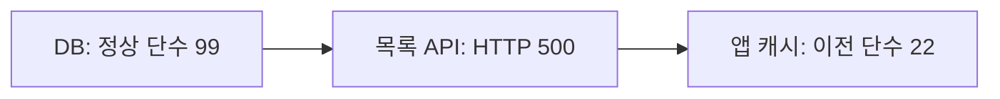
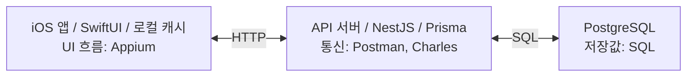
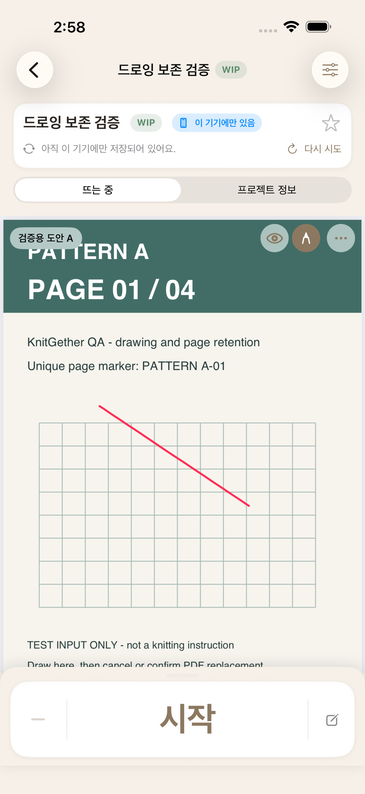
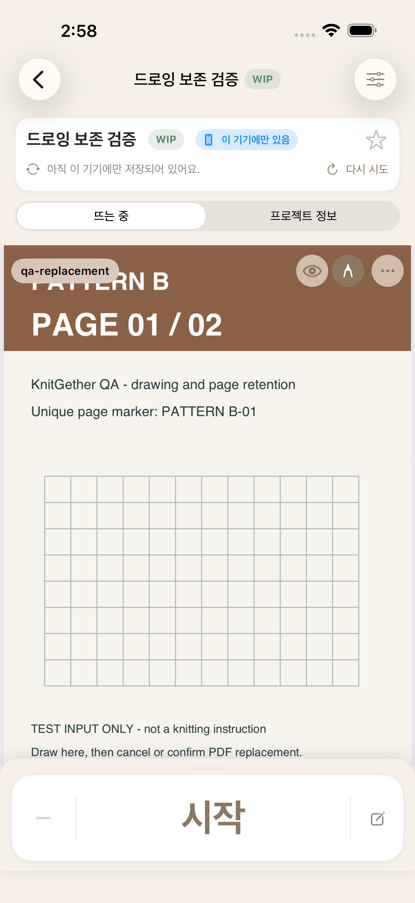
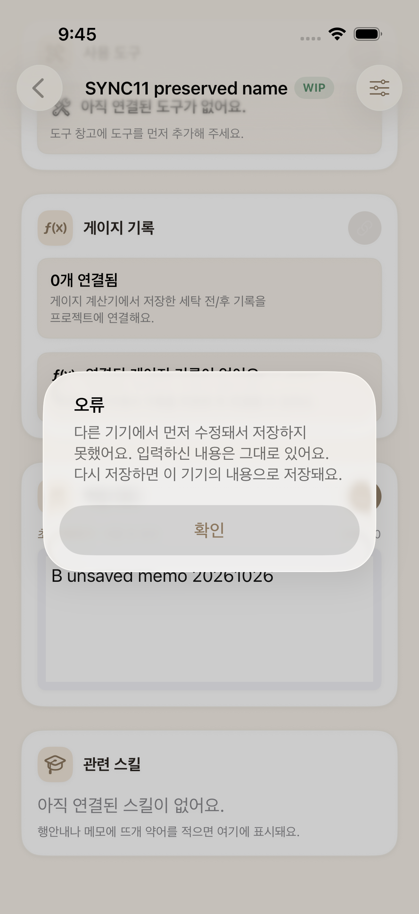

# 뜨개더 QA 포트폴리오

## 뜨개더

**QA Portfolio | 유하은 | 개인 프로젝트**

뜨개질을 시작하면서 도안에 나온 실과 기법을 따로 찾아보는 일이 번거로웠습니다. 필요한 자료와 단수(뜬 줄 수), 메모를 한곳에 모으는 iOS 앱을 기획하고, DB QA에서 하던 검증을 화면과 API까지 연결했습니다.

**사용 기술: SwiftUI, NestJS, Prisma, PostgreSQL**

### 핵심 사용자 흐름과 수행 결과

| 사용자 흐름 | 수행한 경로 | 확인한 결과 |
|---|---|---|
| 첫 사용 | 프로젝트 먼저 생성 / 창고(도안과 재료 보관함)에 등록 후 연결 | 두 경로의 프로젝트와 연결 정보가 같은 결과를 만듦 |
| 작업 재개 | 앱 재실행 → 프로젝트 진입 → 단수 증가 | 로그인과 작업 상태 유지, 증가한 단수의 DB 반영 |
| 기법 찾아보기 | 도안의 기법 태그 → 설명 확인 → 작업 복귀 | 기존 단수와 도안 페이지 유지 |

검증 범위: 위 세 흐름은 최초 수동 수행 기록의 결과입니다. 후속 자동화 결과와 실행 조건은 사례별 링크로 연결했습니다.

### 테스트 범위와 우선순위

기기에만 남은 단수와 메모를 잃으면 복구가 어려워 기록 유실을 P1으로 뒀습니다. 계정 전환 때 타인의 기록이 보일 위험도 P1으로 정하고, 실제 사용 중 가능한 조건에 실패를 추가했습니다.

| 우선순위 | 주요 위험 | 수행 방식 |
|---|---|---|
| P1 최우선 | 기록 유실, 계정 간 노출 | 통신 단절, 서버 거부, 두 기기 충돌과 계정 전환으로 심층 확인 |
| P2 | 조회 계약, 연결 정보 표시, 생성 경로별 차이 | 명세별 TC를 수행하고 API 응답과 SQL 조회를 대조 |
| P3 | 삭제 재시도, 삭제한 참조 항목의 표시 | 핵심 사용자 흐름 안에서 함께 확인 |

### 진행 내용

기획과 TC 설계, Appium UI 테스트를 진행했습니다. Postman과 Charles로 통신을 확인하고, SQL로 저장 결과를 대조했습니다.

**AI 활용:** 앱과 서버 구현, 수정 코드 작성과 반복 테스트 보조에 활용했습니다.

[목록 조회](#list-case) / [도안 교체](#pattern-case) / [동시 수정](#sync-case) / [GitHub](https://github.com/uhaeun/knitgether-app)

[사용자 흐름과 테스트 설계](https://github.com/uhaeun/knitgether-app/blob/fc17e9e77a1d481cd5e365b12d02d5a7be2a1bd3/docs/qa/portfolio/05_test_cases.md) / [최초 수행 결과](https://github.com/uhaeun/knitgether-app/blob/fc17e9e77a1d481cd5e365b12d02d5a7be2a1bd3/docs/qa/portfolio/06_manual_execution.md) / [우선순위 근거](https://github.com/uhaeun/knitgether-app/blob/fc17e9e77a1d481cd5e365b12d02d5a7be2a1bd3/docs/qa/portfolio/03_quality_risk_map.md)

## 목록은 보이는데 단수가 갱신되지 않았습니다

**사례 1 | 조회 실패를 캐시가 가린 문제**

일부 항목에 오류가 있어도 정상 항목을 조회하고, 작성 중인 메모를 보존하도록 보완했습니다.

프로젝트 하나의 단수 정보만 SQL로 지우자 목록 API 전체가 HTTP 500으로 실패했습니다. 정상 프로젝트의 DB 단수를 22에서 99로 바꿔도 화면은 22였습니다. 이전 캐시가 조회 실패를 가리고 있었습니다.

<!-- flow: observed -->

### 요청과 저장값을 대조하며 원인 가설을 좁혔습니다

처음에는 클라이언트의 배열 디코딩 문제를 의심했습니다. HTTP 500 응답을 확인한 뒤 서버를 살펴보니, 한 항목을 응답으로 변환하는 예외가 목록 전체 처리를 멈추고 있었습니다.

정상 항목은 계속 갱신하고, 불완전한 항목은 삭제와 구분하도록 처리 기준을 정했습니다. 개별 조회의 409는 이 앱에서 선택한 오류 구분 계약입니다.

| 대상 | 수정 전 | 수정 후 확인한 결과 |
|---|---|---|
| 목록 API | 전체 HTTP 500 | 200, 정상 항목과 제외 ID 반환 |
| 내 오류 항목 개별 조회 | HTTP 500 | 409와 원인 코드로 구분 |
| 다른 계정의 조회 | 기존 404 | 404 유지, 항목 정보 미노출 |
| 오류 항목의 기기 캐시 | 목록 제외를 삭제로 오인 가능 | 캐시와 미저장 입력 유지, 조회 불가 안내 |

### 수정 확인: 같은 조건을 다시 만들었습니다

전용 시험 DB에서 단수 행 삭제, 삭제 표시, 소유자 불일치 조건을 만들었습니다. 정상 단수 99의 반환과 오류 응답을 확인하고, 조회 전후 단수, 메모, 작업 세션이 바뀌지 않는지 대조했습니다. 시험 전에 확보한 사본으로 복원한 뒤 200 응답도 확인했습니다.

### 회귀: 오류 항목과 실제 삭제를 함께 확인했습니다

Swift 테스트에서 오류 항목의 캐시와 미저장 메모 보존, 실제 삭제 항목 정리, 정상 값 갱신을 확인했습니다. 디스크에서 다시 읽은 뒤에도 같은 상태인지 대조했습니다.

검증 범위: 후속 결과는 API, DB와 Swift 내부 테스트입니다. 해당 회차의 앱 화면을 다시 실행한 결과는 아닙니다.

[API와 SQL 테스트](https://github.com/uhaeun/knitgether-app/blob/f0663a621f4c939f80d172922a40be5a71e40871/qa/api-tests/test_13_row_counter_isolation.py) / [캐시 테스트](https://github.com/uhaeun/knitgether-app/blob/f0663a621f4c939f80d172922a40be5a71e40871/KnitGetherTests/OfflineFirstProjectRepositoryTests.swift) / [응답과 DB 재검증 기록](https://github.com/uhaeun/knitgether-app/blob/1f260ee25bad6fe51b0a9a76b989bee5da500867/docs/qa/validation/2026-10-31/integrity-device/README.md)

## 조건을 나누고 선택별 결과를 확인했습니다

TC는 사전 상태, 조작 순서, 기대 결과와 확인할 데이터로 작성했습니다.

### 사용 기술과 테스트 확인 위치

<!-- flow: architecture -->

| 설계 방법 | 수행한 조건 | 확인 기준 |
|---|---|---|
| 경계값 | 단수 0에서 감소, 음수 입력, 9999에서 증가 | 음수 방지, 조작 횟수와 저장값 일치 |
| 상태 전이 | API 단절 중 생성, 재실행, 복구 후 목록 조회 | 로컬 기록 보존과 동기화 상태 전환 |
| 오류 주입 | 서버의 실제 400 거부, 필수 단수 정보 행 삭제 | 실패 안내, 입력 보존과 DB 상태 |
| 결정 테이블 | 도안 교체의 확인창, 삭제 안내, 취소와 승인 | 취소 시 보존, 승인 시 교체와 표시선 제거 |

### 사례 2: 도안 교체 명세와 실제 동작 대조

TC 설계 단계에서 취소와 승인 기준을 명세로 구체화했습니다. 실제 앱은 삭제 안내 없이 도안 위에 그린 표시선을 지워 기준을 충족하지 못했습니다. 수정 후 취소, 승인, 재실행을 나눠 확인했습니다.

<!-- photo-width: 80 -->

| 취소: 기존 도안과 표시선 유지 | 승인: 새 도안으로 교체, 표시선 제거 |
|:---:|:---:|
|  |  |

재실행 후 교체 상태 유지, 홈과 기법 설명에서 복귀 후 도안 페이지 유지를 확인했습니다.

검증 범위: 기존 설치 앱에서 확인한 로컬 화면입니다. 소스 버전은 미확정이며, 상세 실행 조건은 링크에 정리했습니다.

[최초 수행과 결함](https://github.com/uhaeun/knitgether-app/blob/fc17e9e77a1d481cd5e365b12d02d5a7be2a1bd3/docs/qa/portfolio/06_manual_execution.md) / [UI 테스트 코드](https://github.com/uhaeun/knitgether-app/blob/f0663a621f4c939f80d172922a40be5a71e40871/qa/appium/capture_portfolio.py) / [화면과 실행 기록](https://github.com/uhaeun/knitgether-app/blob/1f260ee25bad6fe51b0a9a76b989bee5da500867/docs/qa/submission/evidence/2026-10-04/README.md)

## 충돌 뒤에도 작성 중인 메모는 남겨야 했습니다

**사례 3 | 두 기기 동시 수정과 재저장**

같은 계정으로 프로젝트를 두 기기에서 열고, B에 입력한 뒤 A 저장, B 저장 순서로 충돌을 만들었습니다.

미저장 메모가 화면 메모리에만 있어 앱을 종료하면 사라졌습니다. 계정과 프로젝트별로 초안을 보존하는 기준을 정하고 파일에 기록하도록 보완했습니다. 충돌 후에는 입력을 유지하고 재조회 후 직접 저장합니다.

| 순서 | 확인한 결과 |
|---|---|
| B 입력 → A 저장 → B 저장 | HTTP 409, DB의 A 메모 유지 |
| B의 충돌 화면 | 안내와 B 입력 유지 |
| B에서 직접 재저장 | DB에 B 메모 저장, 시험한 다른 필드 유지 |
| 앱 종료 후 재실행 | 초안 복구, 버리기 후 미복구 |

| 충돌 안내와 남아 있는 미저장 메모 |
|:---:|
|  |

검증 범위: 두 시뮬레이터에서 기본 12개는 UI와 API를 함께 사용했고, 보완 7개는 양쪽 변경을 화면에서 수행했습니다. 자동 재저장이 없는지는 300초간 관찰했습니다.

[두 기기 UI 테스트](https://github.com/uhaeun/knitgether-app/blob/b2f916bb9b248291a7f7ef421eb7739fda103d11/qa-runs/2026-10-26-session-fix/run_pure_ui.py) / [화면과 DB 결과](https://github.com/uhaeun/knitgether-app/blob/1f260ee25bad6fe51b0a9a76b989bee5da500867/docs/qa/submission/evidence/2026-10-26/README.md) / [초안 보존과 수정 근거](https://github.com/uhaeun/knitgether-app/blob/b2f916bb9b248291a7f7ef421eb7739fda103d11/qa-runs/2026-10-26-session-fix/report.md)

### 후속 회귀와 실기기 확인

연관 기록과 파일 변경 뒤의 오래된 저장, 동시 요청과 롤백까지 후속 자동화로 보완했습니다.

| 테스트 | 결과와 범위 |
|---|---|
| 실제 HTTP와 PostgreSQL | 40개 통과: 경합, 롤백, 연관 데이터와 파일 |
| API, 네트워크와 DB (pytest) | 79개 모두 통과 |
| Swift 내부 테스트 | 365개 통과 / 41개 묶음 |
| iPhone 16 Pro 로컬 흐름 | 단수 종료 후 복귀, 카메라 거부 안내 후 복귀 각각 최종 통과 |

집계 기준: 테스트별 건수는 합산하지 않았습니다. 실기기 2개는 서로 다른 최종 실행의 고유 시나리오입니다.

실기기 가입과 서버 동기화를 시도할 때 로컬 네트워크 접근 거부가 관찰돼 완료하지 못했습니다. 접근 거부의 원인은 확인하지 못했습니다. 장시간 부하와 여러 OS 및 기기 조합은 미검증입니다.

[회귀 소스와 실기기 조건 및 실패 이력](https://github.com/uhaeun/knitgether-app/blob/1f260ee25bad6fe51b0a9a76b989bee5da500867/docs/qa/validation/2026-10-31/integrity-device/README.md)
