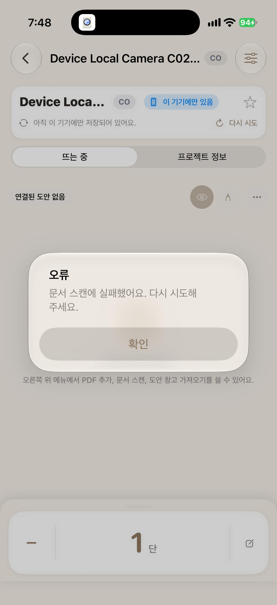
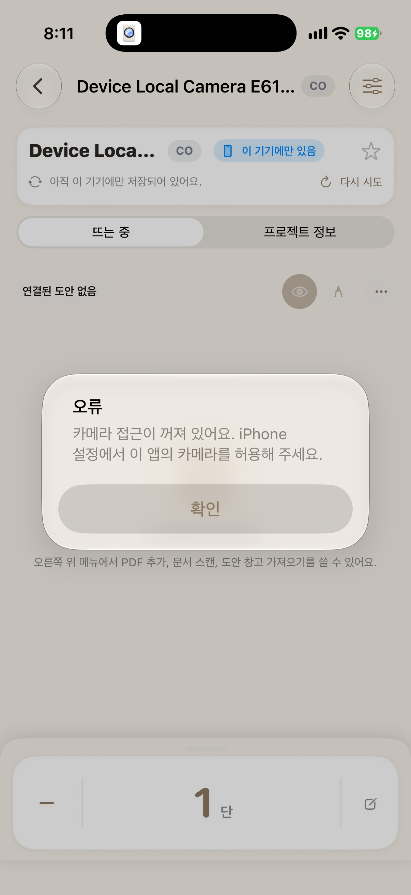

# 불완전한 프로젝트 조회와 기기 검증

확인일: 2026-10-31, Asia/Seoul. 제품·계층별 회귀 소스: `82acccc8a2ce64fd2b97af2fb2a2463e5e549705`. 후속 카메라 안내·실기기 시험 소스: `5bcbaaef9907f8c458f5218c6fd0b22decb64f25`. 조회·저장 로직은 유지하고 작업 화면의 카메라 거부 안내와 기기 검사를 추가했습니다. 최종 기기 시험의 대화상자 처리 소스는 `f0663a621f4c939f80d172922a40be5a71e40871`이며 앱 소스는 `5bcbaae`와 같습니다.

이 보완의 분석·구현·자동 시험과 기록 작성은 AI가 수행했습니다. 실제 기기의 연결·인증과 설치 환경 변경은 사용자와 함께 진행했습니다.

## 개별 조회의 처리 기준

프로젝트의 필수 단수 정보가 삭제·삭제 표시·소유자 불일치 상태이면 기존 개별 조회는 `PROJECT_ROW_COUNTER_MISSING`과 HTTP 500을 반환했습니다. 서버가 중단된 것은 아니며, 변환 단계가 이 상태를 명시적으로 오류 처리했습니다. 결손은 전용 시험 DB에서 SQL로 주입했습니다. 정상 사용 중 같은 결손이 발생했다고 주장하지 않습니다.

이번 조회 계약은 아래와 같이 정했습니다.

| 조건 | 응답·처리 |
|---|---|
| 프로젝트와 단수 정보가 정상 | 200과 저장된 값 |
| 내 프로젝트는 있으나 필수 단수 정보를 사용할 수 없음 | 409, `PROJECT_ROW_COUNTER_MISSING`, 해당 프로젝트 ID |
| 프로젝트가 없거나 다른 계정의 소유 | 기존 404, `PROJECT_NOT_FOUND` 유지 |
| 목록에 일부 불완전한 항목이 있음 | 정상 항목은 200 배열로 반환하고 제외한 ID를 별도 헤더로 전달 |

409는 이 서비스에서 선택한 계약입니다. [현재 리소스 상태와의 충돌을 나타내는 HTTP 정의](https://www.rfc-editor.org/rfc/rfc9110.html#section-15.5.10)를 참고했습니다. 존재하는 프로젝트를 삭제된 것으로 취급하거나, 단수를 임의의 0으로 만들어 성공 응답을 주지 않습니다. GET은 복구를 수행하지 않습니다.

## 목록에서 제외된 항목과 실제 삭제를 구분

기존 앱은 서버의 전체 목록에 없는 동기화 완료 항목을 로컬에서 정리했습니다. 서버가 오류 항목만 제외한 경우에도 같은 판단이 적용될 수 있었습니다.

목록 응답의 `X-KnitGether-Unavailable-Projects`에 제외한 프로젝트 ID를 전달합니다. 기존 배열 본문은 유지합니다. 앱은 해당 로컬 캐시를 보존하면서 정상 항목의 최신값과 실제 삭제를 계속 반영합니다. 서버 상태를 확인하지 못한 항목이 있음을 목록에 안내하고, 개별 상태 재확인의 409도 미저장 메모와 단수를 유지한 채 표시합니다. 잘못된 헤더는 정상적인 전체 목록으로 받아들이지 않습니다.

이는 캐시 보존과 오류 구분입니다. 유실된 단수 값을 추정하거나 모든 자식 기록을 자동 복원하는 기능은 아닙니다.

## 회귀 시험

| 검증 | 결과 | 확인 범위 |
|---|---|---|
| 서버 회귀 | 180 PASS | 기존 HTTP 계약·입력·저장 경로 포함 |
| 실제 PostgreSQL·HTTP | 40 PASS | 경합, 롤백, 자식 데이터·파일 정합성 |
| API·네트워크·DB | 79 PASS / 0 xfail | 기존 알려진 실패를 조건별 회귀로 전환 |
| 결손 관련 API 재확인 | 5 PASS | 목록 2조건, 개별 조회 3조건; 전체 79개에 포함 |
| Swift 내부 시험 | 365 PASS / 41 suites | 기존 359개와 보존·오류 구분 6개 |
| 실제 iPhone 비로그인·로컬 | 최종 2 PASS | 단수의 종료·복귀 보존, 카메라 거부 안내·복귀 |
| 실제 iPhone 계정·서버 연결 | 미완료 | 가입 요청이 로컬 네트워크 정책으로 차단 |

추가한 Swift 시험은 단수·메모 초안 보존, 캐시의 디스크 재로딩, 실제 삭제 항목 정리, 정상 값 갱신, 헤더 해석, 안내 해제를 확인합니다. 계층별 수치를 합산해 전체 E2E 건수로 표시하지 않습니다.

[로컬 판정 요약](evidence/local-results.json)과 [원격 CI·개별 로그 결과](evidence/ci-results.json)를 보존했습니다. 원격에서도 서버 180·PostgreSQL 40·API 79·Swift 365·UI smoke 3개가 통과했고 Windows·Linux의 파일 경로 회귀는 각각 33개 통과했습니다. 경로 33개는 서버 180개에 포함됩니다.

[HTTP 응답·SQL 전후 상태](evidence/http-sql.json)에는 결손 주입 전, 조회 전·후, 복원 후를 구분했습니다. 조회가 프로젝트·작업 세션을 바꾸지 않았고 정상 프로젝트도 보존됐습니다. 다른 계정에는 결손 상태와 ID를 노출하지 않았습니다. 복원 확인에서는 **시험에서 확보한 정확한 카운터 사본**을 SQL로 되돌렸습니다. 운영 복구 도구를 구현한 결과가 아닙니다.

보완 전 강화한 기준으로 실행한 4개는 실패했습니다. 목록의 제외 ID 전달이 없었고 개별 조회가 500이었습니다. 보완 후 첫 API 전체 실행의 5개 실패는 네트워크 프록시가 전용 3318번 대신 기존 3000번 서버를 참조한 준비 오류였습니다. `KG_NETGATE_FORWARD_PORT=3318`로 맞춘 뒤 전체 79개와 변경한 결손 5개를 다시 확인했습니다. 이를 제품 수정의 효과로 집계하지 않습니다.

## 실제 기기의 시험 조건

기기: iPhone 16 Pro, iOS 27.0.1. Xcode 26.6에서 기존 뜨개더와 다른 bundle ID의 QA 앱을 빌드했습니다. 별도 계정·DB·저장 디렉터리·API 포트를 사용합니다.

처음에는 가입·저장, 백그라운드·프로세스 종료 후 단수 보존, 통신 실패 후 서버 저장, 카메라 권한 거부 후 복귀를 시도했습니다. 가입 단계의 로컬 네트워크 차단으로 네 흐름 모두 진행하지 못했습니다. 앱과 실행기의 권한은 별개였으며 실행기는 허용 후 HTTP 401 응답을 받았습니다. 앱은 권한 초기화·허용·재시도, 재설치·재시동과 새 식별자에서도 `-1009 / Local network prohibited`가 반복됐습니다. 자동화 밖의 직접 실행도 같았으므로 원인을 자동화에만 한정하지 않습니다. [준비와 실패 관측값](evidence/device-preparation.json)

이 차단에 의존하지 않는 비로그인 흐름을 별도로 설계했습니다. 계정 단계를 건너뛰는 앱의 지원 경로에서 프로젝트를 만들고 단수 1을 기록한 뒤, 백그라운드·재실행과 카메라 권한 거부 후 복귀를 확인합니다. 서버 연결이 필요한 기존 네 시나리오를 통과로 바꾸거나 대체 집계하지 않습니다. 통신 실패는 앱의 API 주소를 연결되지 않는 포트로 바꾸어 유도합니다. Wi-Fi·이동통신 전환 시험과 구분합니다. 카메라 권한 거부는 QA 앱에만 적용하며 실제 촬영 품질은 이 시험의 범위가 아닙니다.

최초 설치는 무료 개발자 프로필의 앱 수 제한으로 차단됐습니다. 사용자 승인으로 설치 공간을 확보한 뒤 별도 QA 앱·자동 실행기를 설치했습니다. 기기 신뢰·UI 자동화 인증 단계에서 중단된 실행은 화면 시험의 통과나 제품 실패로 집계하지 않습니다.

## 카메라 거부 뒤의 안내와 복귀

비로그인 시험의 첫 실패는 펼쳐진 카운터 시트가 도안 메뉴를 가린 상태에서 스캔을 누르려 한 조작 오류였습니다. 시트를 접고 스캔 메뉴 도착을 확인하도록 보완했습니다. 다음 실행에서는 실제 카메라 권한 요청을 거부했지만 앱 오류창을 닫지 않은 상태에서 카운터를 조작해 실패했습니다. iOS 스캐너의 `Camera Unavailable` → `OK` → `Cancel` 뒤에 앱 오류창이 나타나는 순서를 확인했습니다. 두 계층의 안내창을 나누어 표시·문구·닫힘을 확인하도록 판정을 보완했습니다.

실제 오류창은 권한 거부에도 “문서 스캔에 실패했어요. 다시 시도해 주세요.”만 안내했습니다. 권한이 꺼진 상태에서는 단순 재시도로 해결되지 않으므로 작업 화면에 **iPhone 설정에서 이 앱의 카메라를 허용하라는 안내**를 추가했습니다. 기기 제한 상태는 별도 문구로 구분하며, 제한 상태 자체는 이번 실기기 실행 범위가 아닙니다. 도안 창고의 모든 스캔 경로를 확인한 결과로 확대하지 않습니다.

최종 결과는 단수 종료·복귀 보존 **1 PASS**, 카메라 거부 후 설정 안내·복귀 **1 PASS**입니다. 서로 다른 최종 실행의 고유 시나리오 2개이며, 마지막 카메라 재실행은 해당 1개만 선택했습니다. 앞선 비로그인 회차의 1 PASS·1 FAIL들과 계정 흐름의 실패를 함께 보존합니다. [시나리오·조건·실패 이력·사진 해시](evidence/device-results.json) / [기계 추출한 xcresult·시험 로그](evidence/device-log-summary.json)

| 보완 전 일반 실패 안내 | 보완 후 권한·설정 안내 |
|---|---|
|  |  |

[백그라운드·재실행 후 단수 1](evidence/counter-after-relaunch.png) / [권한 안내를 닫고 돌아온 단수 1](evidence/camera-denied-return.png)

[실기기 로컬 흐름 코드](../../../../../KnitGetherUITests/DeviceLocalFlowTests.swift) / [서버 연결 준비 검사](../../../../../KnitGetherUITests/DeviceNetworkPreflightTests.swift)

## 재현

기존 개발 DB가 아닌 새 전용 DB와 서버를 준비합니다. 다음은 이번 전용 환경의 실행값입니다.

```sh
API_BASE_URL=http://127.0.0.1:3318/api/v1 \
KG_NETGATE_FORWARD_PORT=3318 \
DB_HOST=localhost DB_PORT=5432 DB_USER=yuha DB_PASSWORD='' \
DB_NAME=knitgether_qa_detail_20261031 \
FILE_STORAGE_ROOT=/tmp/knitgether-detail-files-20261031 \
pytest -q qa/api-tests
```

실기기는 기존 앱과 구분되는 앱·실행기 bundle ID로 빌드하고 서명합니다. 비로그인 로컬 흐름은 다음 선택으로 실행합니다. `.xctestrun`은 빌드 결과의 `Build/Products` 안에 둡니다.

```sh
xcodebuild test-without-building \
  -xctestrun /path/to/Build/Products/QA.xctestrun \
  -destination "platform=iOS,arch=arm64,id=$DEVICE_UDID" \
  -only-testing:KnitGetherUITests/DeviceLocalFlowTests \
  -parallel-testing-enabled NO
```

서버 연결 준비 검사 `DeviceNetworkPreflightTests`는 기능 흐름과 별도로 실행합니다. 실행기의 401 응답은 인증 정보를 넣지 않은 준비 요청의 기대 결과입니다. 앱의 권한이나 가입·동기화 통과를 증명하지 않습니다.

실기기의 서버 주소는 해당 기기에서 접근할 수 있는 Mac의 LAN 주소를 사용합니다. XCTest 실행기에는 `KG_API_BASE_URL`, 앱 실행 환경에는 `KNITGETHER_API_BASE_URL`이 전달됐는지 확인해야 합니다. 시험 계정과 DB 관측으로 서버 저장을 대조합니다.

## 남은 검증

한 기기의 제한된 흐름과 지정한 결손·경합 조건에 대한 결과입니다. 장시간 지속 부하, 실제 Wi-Fi·이동통신 전환, 여러 OS·기기 조합, 실제 스캔·촬영 품질은 별도 범위입니다. 장시간 시험은 요청 수보다 종료 후 기록 누락·중복과 자원 사용 증가를 확인할 수 있도록 환경·지속 시간·동시 사용자·데이터 규모·판정 기준부터 정해야 합니다.
