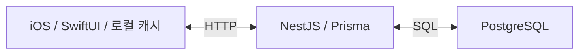

# 앱과 서버 실행 환경

## 구성



- `KnitGether/`: iOS 앱. Repository 계층에서 API와 기기 저장소를 연결합니다.
- `server/`: API, Prisma schema와 DB 마이그레이션, 서버 테스트입니다.
- `qa/`: Appium, API 테스트, Postman 요청과 테스트 도구입니다.
- `KnitGetherTests/`: Swift 내부 로직 테스트입니다.
- `KnitGetherUITests/`: 기본 UI, 실제 기기 흐름과 네트워크 준비 테스트입니다.
- `KnitGetherQAUITests/`: DEF-15 카운터 하한 회귀와 페이지 객체입니다.

## 서버

Node.js 20 이상과 Docker Compose가 필요합니다. 저장소 루트에서 실행합니다.

```sh
cd server
cp .env.example .env
npm ci
npm run prisma:generate
docker compose up -d
npx prisma migrate deploy
npm run start:dev
```

예시 구성의 PostgreSQL은 호스트 5433 포트, API는 3000 포트를 사용합니다. 값은 `server/docker-compose.yml`과 `server/.env.example`에서 확인합니다. 기본 API 주소는 `http://127.0.0.1:3000/api/v1`입니다.

API 테스트는 개발 데이터와 분리한 DB를 준비해 수행합니다. 별도 DB와 네트워크 프록시 설정은 [API 실행 안내](../qa/api-tests/README.md)를 따릅니다.

## iOS

`KnitGether.xcodeproj`를 Xcode에서 열고 목적에 맞는 공유 scheme을 선택합니다. 기존 실행 기록의 Xcode 버전은 26.6입니다.

| Scheme | 용도 |
|---|---|
| KnitGether Local Offline | 서버 주소 없이 시뮬레이터의 로컬 저장 흐름 확인 |
| KnitGether Local Simulator | Mac의 3000 포트 API와 시뮬레이터 연결 |
| KnitGether Local Device | 실제 iPhone에서 Mac의 API에 연결 |

실기기는 Mac과 같은 네트워크에서 접근할 수 있는 주소를 `KNITGETHER_API_BASE_URL`에 지정합니다. 개발 scheme의 `haeun.local`은 이 프로젝트를 실행했던 Mac의 주소이므로 실행 환경에 맞게 바꿉니다. 앱을 아이콘으로 직접 열 때 사용하는 주소는 `AppRepositoryContainer.standaloneDeviceAPIBaseURL()`에 있습니다.

온라인 모드에서 통신을 끊는 조건과, 서버를 사용하지 않는 시뮬레이터 로컬 모드는 서로 다릅니다. 전자는 API 복구 후 동기화까지 확인하며, 후자는 기기의 파일 저장을 확인합니다.

## 테스트

| 대상 | 실행 안내 |
|---|---|
| Appium UI | [환경과 실행](../qa/appium/README.md) |
| API와 DB | [환경과 실행](../qa/api-tests/README.md) |
| Postman 기본 요청 | [컬렉션과 사용법](../qa/postman/README.md) |
| 결함 주입 | [실험 도구](../qa/mutation/README.md) |
| 테스트 도구의 판정과 복원 | [도구 회귀](../qa/tooling-tests/README.md) |

시뮬레이터 초기화, 데이터 주입과 결함 주입은 개인 기록이 없는 전용 환경에서 수행합니다. 실제 iPhone의 완료 범위와 서버 연결 실패 조건은 [실기기 결과](qa/evidence/2026-10-31/README.md)에 기록했습니다.

## CI

- `ci.yml`: main과 PR의 서버, 실제 PostgreSQL, API, iOS 내부 테스트와 UI smoke입니다.
- `qa-gate.yml`: 수동 실행과 기존 QA 브랜치의 DEF-15 전용 회귀입니다.
- `storage-compatibility.yml`: Windows와 Linux의 파일 경로 회귀입니다.

각 실행 수치는 [수행 기록](qa/test-results.md)에 적힌 커밋과 환경에 해당합니다.
